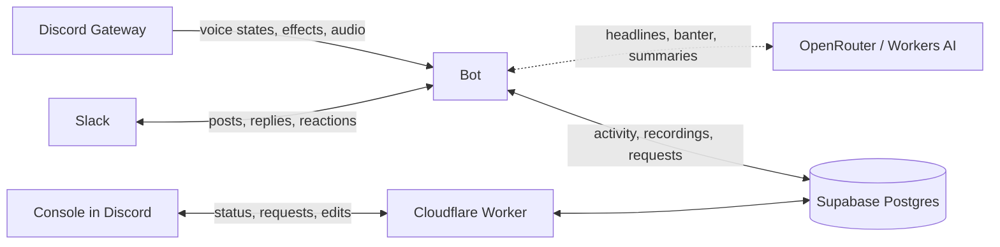

<p align="center"></p>

# Virtual Office Notifier

[](https://github.com/push-based/virtual-office-notifier/actions/workflows/ci.yml)

A bot for a team whose office is a Discord voice channel. It tells Slack when the office opens and when it empties, invites people in on weekdays, and chats about what's been going on. From the Console, a Discord Activity in the office, anyone can record what's said and get a summary with action items in Slack, browse past recordings, and see who's been in and when.

## What it does

**In Slack**

- **Announces when the office opens and when it empties**, and nothing in between. The first person in opens it and the last one out empties it, with a recap of how long it was open and how many people stopped by. [More](docs/slack.md#when-it-posts)
- **Reminds people on weekdays** at 11:15 office time to come hang out.
- **Writes banter** about what's happened in the office, up to five times a working day, at random. [More](docs/slack.md#banter)
- **Answers** when someone mentions it, and when Clef, a decision model, thinks a reply under one of its posts wants one. Capped per day and per thread, and switched on in the database. [More](docs/slack.md#answering-in-slack)
- **Lets free AI models write the headlines and button labels**, on OpenRouter or Workers AI, with fixed phrasings when none answers. [More](docs/slack.md#ai-headlines)

**In Discord**

- **Sits in the office while it's occupied**, muted and deafened, so it sees soundboard sounds and emoji reactions. It never hears anything unless someone records. [More](docs/architecture.md#the-bot-in-the-office)
- **Records on demand.** Anyone in the office opens the Console and presses Start. Each person's speech is transcribed with Whisper, and the summary and action items land in Slack with the full transcript. Pause to go off the record, and give a recording a title, an agenda and a summary style. [More](docs/recording.md)
- **Shows the recording history and office stats** in the Console: every recording with its transcript and summary, and for this week, this month or all time, who was in for how long, first in and last out, the busiest hours and the soundboard leaderboard. [More](docs/recording.md#recording-history)

**Behind it**

- **Records voice activity** to Postgres: joins, leaves, mute, deafen, camera, streaming, sounds and reactions, exactly as Discord reports them. The database can never stop the announcements. [More](docs/database.md)
- **Keeps going** through Slack outages, restarts mid-occupancy and a database that's down. Failures are retried and logged, and reported to Sentry when it's configured. [More](docs/operations.md#monitoring)

## What it looks like

> 🎙️ **Ada** opened the virtual office — everyone's welcome to join!
>
> `🎧 Join the office`
>
> 🔊 Opened on Discord at 4:05 PM

> 🎬 Wednesday's crew arrived like a flash mob: Barbara, Alan, Grace and Linus all joined within 8 minutes, cameras snapped on in unison, then off together 40 minutes later.
>
> `🚪 Join the ensemble`
>
> ✨ Banter by nvidia/nemotron-3-ultra-550b-a55b:free · 🤖 AI is a hallucination machine.

The rest of the cards are in [What it posts in Slack](docs/slack.md#the-cards).

## How it fits together

Discord only pushes voice-state changes over its Gateway WebSocket, so the bot is an always-on Node.js process, written in TypeScript with [Effect](https://effect.website). It listens to Slack over Socket Mode, so it needs no public endpoint either. The Console is an Angular page served by a Cloudflare Worker, which talks to the bot through the database.



[How it works](docs/architecture.md) has the full diagram, how events are handled, and what each module does.

## Getting started

You'll need Node 26 (see `.nvmrc`), pnpm, a Discord bot and a Slack app. [Setting it up](docs/setup.md) walks through creating both.

```bash
git clone https://github.com/push-based/virtual-office-notifier.git
cd virtual-office-notifier
pnpm install
cp .env.example .env   # then fill in the values
pnpm --filter bot dev
```

Once it logs `Watching the virtual office`, join the office channel and the post should show up in Slack. Everything else, the AI providers, the database, the Console and Sentry, is optional and switched on by configuring it.

> [!WARNING]
> Use a separate Discord bot and Slack app for local runs while production is running. Two copies watching the same channel post every announcement twice.

## Docs

| Doc                                            | For                                                                                                                                          |
| ---------------------------------------------- | -------------------------------------------------------------------------------------------------------------------------------------------- |
| [Setting it up](docs/setup.md)                 | Creating the Discord bot and Slack app, every configuration variable, and turning on the AI providers, the database, the Console and Sentry. |
| [What it posts in Slack](docs/slack.md)        | The cards, when each one is posted, how the AI headlines and banter are written, and how answering in Slack decides what to do.              |
| [Recording the office](docs/recording.md)      | Recording from the Console: starting, pausing, titles and agendas, summaries, action items, the history and the office stats.                |
| [The database](docs/database.md)               | Every table and view, and what happens when the database is down.                                                                            |
| [How it works](docs/architecture.md)           | The process, how events are handled, the bot's presence in the office, and the module map.                                                   |
| [Running it in production](docs/operations.md) | The VM, deploying from CI, logs, Sentry and troubleshooting.                                                                                 |
| [Privacy](docs/privacy.md)                     | What each feature sends where, and what to tell the team before turning it on.                                                               |
| [CONTEXT.md](CONTEXT.md)                       | The words the code and the docs use, and what to avoid.                                                                                      |
| [CONTRIBUTING.md](CONTRIBUTING.md)             | The toolchain, the checks and what a pull request needs.                                                                                     |

## Privacy

This broadcasts people's presence to a wider audience, keeps a detailed record of everyone's activity in the office, and, feature by feature, sends names, messages and speech to AI providers that may keep and train on them. Nothing is ever deleted. Tell the team before turning each feature on. [Privacy](docs/privacy.md) says exactly what goes where.

## Contributing

Issues and pull requests are welcome. See [CONTRIBUTING.md](CONTRIBUTING.md) for how to set up, what the checks are and what a pull request needs. To report a security problem, follow [SECURITY.md](SECURITY.md) instead of opening an issue.

## License

[0BSD](LICENSE). Use it for anything, with no conditions. It comes with no warranty, and I'm not liable for anything that comes of using it.
