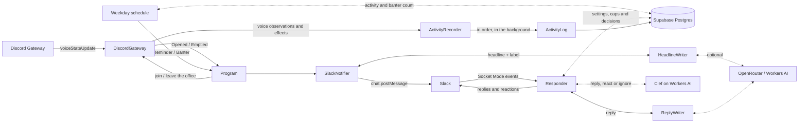

# How it works

For developers. The words used here are defined in [`CONTEXT.md`](../CONTEXT.md), and the toolchain, checks and conventions are in [`CONTRIBUTING.md`](../CONTRIBUTING.md).

- [Overview](#overview)
- [Handling events](#handling-events)
- [The bot in the office](#the-bot-in-the-office)
- [Modules](#modules)
- [Workspace layout](#workspace-layout)

## Overview

Discord only pushes voice-state changes over its Gateway WebSocket, so the bot is an always-on Node.js process rather than a webhook or serverless function. It's written in TypeScript with [Effect](https://effect.website) v4, uses [discord.js](https://discord.js.org) to receive `voiceStateUpdate` events, and posts to Slack with a bot token through `chat.postMessage`. It listens to Slack over a [Socket Mode](https://api.slack.com/apis/socket-mode) WebSocket, so the VM needs no public endpoint either.

The Console, a Discord Activity, sits beside the bot: an Angular page and a Cloudflare Worker that share the database with it. The page files recording requests and recording edits as rows, and the bot picks them up. The two never talk to each other directly. See [Recording the office](recording.md).

## Handling events

Office events are handled one at a time, so one that arrives while a Slack post is being retried waits its turn and messages stay in order.

Each call to Slack's Web API times out after 10 seconds and is retried up to 4 times with jittered exponential backoff from 1 second, or after Slack's `Retry-After` when rate-limited (`ratelimited` or a 429). Slack answers `200` with `ok: false` when it refuses something, so failures are told apart by Slack's error code: `invalid_auth`, `token_revoked`, `account_inactive`, `channel_not_found` and `not_in_channel` mean the bot has lost access, and anything else means it rejected what was sent. Neither is retried. Posting a message and attaching an uploaded file aren't safe to repeat, since Slack may have acted on a request that timed out, so those two are only retried when Slack answered that it did nothing: rate-limited or a 5xx. A timeout or a dropped connection isn't retried. Either way the failure is logged and the next event is handled as normal.

Everything else runs in its own fiber, so nothing can hold up or stop the announcements:

- [Answering in Slack](slack.md#answering-in-slack) handles Slack events on its own, thread by thread.
- Recording voice activity buffers observations and writes them in the background, and keeps going through a database outage. See [When the database is down](database.md#when-the-database-is-down).
- [Recording on demand](recording.md) captures audio, transcribes clips and posts summaries alongside, so a slow Slack post never holds it up.

## The bot in the office

Discord only sends soundboard sounds and emoji (`voiceChannelEffectSend`) to clients in the voice channel. So while anyone is in the office, the bot is too: it joins when the office opens and leaves when it empties, already muted and deafened. It only sends the gateway's voice-state message and never opens an audio connection, so it can't hear or send anything. It also leaves an empty office at startup, in case an earlier run left it behind. Whenever its Discord connection comes back after a drop, it goes back to where it should be. If someone disconnects it by hand, it's back the next time the office opens.

The one exception is a [recording](recording.md): for as long as one is on, the bot un-deafens, opens an audio connection and is renamed `🔴 Recording`, so everyone in the channel can see it's listening. It goes back to muted and deafened the moment the recording stops or is paused, and is renamed `⏸️ Recording paused` while paused. Renaming needs the Change Nickname permission; without it the bot logs a warning and records anyway.

## Modules

Everything the bot does lives in [`apps/bot/src/`](../apps/bot/src). The top level holds the program: `main.ts`, `Program.ts`, `Config.ts`, `Observability.ts` and `Storage.ts`, which sets up every store. Everything else sits in a folder per concern, and each folder's `index.ts` is its interface: code outside a folder only imports its `index.ts`, while tests in [`apps/bot/test/`](../apps/bot/test) mirror the folders and can test the internals.

**Entry point and the program**

| Module                                                 | Responsibility                                                                                         |
| ------------------------------------------------------ | ------------------------------------------------------------------------------------------------------ |
| [`main.ts`](../apps/bot/src/main.ts)                   | Entry point. Provides the layers and runs the program.                                                 |
| [`Program.ts`](../apps/bot/src/Program.ts)             | Merges office events with reminders and posts each one to Slack, and records voice activity alongside. |
| [`Config.ts`](../apps/bot/src/Config.ts)               | Environment variables and the default model lists.                                                     |
| [`Observability.ts`](../apps/bot/src/Observability.ts) | Sends errors, traces and logs to Sentry when it's configured.                                          |

**The office**, in [`apps/bot/src/office/`](../apps/bot/src/office): the Discord side, and office time.

| Module                                                              | Responsibility                                                                                                                                                                 |
| ------------------------------------------------------------------- | ------------------------------------------------------------------------------------------------------------------------------------------------------------------------------ |
| [`DiscordGateway.ts`](../apps/bot/src/office/DiscordGateway.ts)     | Logs in to Discord, finds the office channel, turns voice-state updates into office events and observations to record, and is the Discord side of moving and renaming the bot. |
| [`OfficeEvent.ts`](../apps/bot/src/office/OfficeEvent.ts)           | The event types and the occupancy tracking that decides when the office opens or empties.                                                                                      |
| [`BotPresence.ts`](../apps/bot/src/office/BotPresence.ts)           | Whether the bot should be in the office, from who's there at startup and the office opening and emptying.                                                                      |
| [`OfficeSeat.ts`](../apps/bot/src/office/OfficeSeat.ts)             | Where the bot sits: in or out of the office, stepping out while recording so the audio connection can join, its nickname, and going back after Discord reconnects.             |
| [`VoiceObservation.ts`](../apps/bot/src/office/VoiceObservation.ts) | Decides which voice-state updates are worth recording.                                                                                                                         |
| [`VoiceEffect.ts`](../apps/bot/src/office/VoiceEffect.ts)           | Soundboard sounds and emoji, and which ones are worth recording.                                                                                                               |
| [`OfficeTime.ts`](../apps/bot/src/office/OfficeTime.ts)             | Office time: the UTC+2 zone, the office day and week, office hours and the office clock.                                                                                       |

**Slack**, in [`apps/bot/src/slack/`](../apps/bot/src/slack): Slack itself, used by announcing, answering and recording through its `index.ts`.

| Module                                                     | Responsibility                                                                                        |
| ---------------------------------------------------------- | ----------------------------------------------------------------------------------------------------- |
| [`SlackClient.ts`](../apps/bot/src/slack/SlackClient.ts)   | Slack's Web API: posting, reacting, reading threads and names, with retries and error classification. |
| [`SlackSocket.ts`](../apps/bot/src/slack/SlackSocket.ts)   | The Socket Mode connection: acks every event at once, drops redeliveries and reconnects.              |
| [`SlackEvent.ts`](../apps/bot/src/slack/SlackEvent.ts)     | Decodes Slack events and decides which ones the bot considers.                                        |
| [`SlackMessage.ts`](../apps/bot/src/slack/SlackMessage.ts) | The Block Kit pieces every message is built from, and escaping text from outside.                     |
| [`BotPosts.ts`](../apps/bot/src/slack/BotPosts.ts)         | Every post the bot makes in Slack: posts it and records it, and a failed record never hides the post. |
| [`SlackHistory.ts`](../apps/bot/src/slack/SlackHistory.ts) | Reads the responder settings and keeps the Slack posts, messages, decisions and reactions.            |

**Announcing**, in [`apps/bot/src/announcing/`](../apps/bot/src/announcing): the announcements, the reminder and banter. Program uses its `index.ts`.

| Module                                                              | Responsibility                                                                            |
| ------------------------------------------------------------------- | ----------------------------------------------------------------------------------------- |
| [`SlackNotifier.ts`](../apps/bot/src/announcing/SlackNotifier.ts)   | Posts the announcements, reminders and banter.                                            |
| [`Announcement.ts`](../apps/bot/src/announcing/Announcement.ts)     | Builds each announcement, reminder and banter message, including the fixed phrasings.     |
| [`HeadlineWriter.ts`](../apps/bot/src/announcing/HeadlineWriter.ts) | Asks the AI providers for a headline or banter and a button label, and checks the reply.  |
| [`Reminder.ts`](../apps/bot/src/announcing/Reminder.ts)             | The weekday reminder schedule.                                                            |
| [`Banter.ts`](../apps/bot/src/announcing/Banter.ts)                 | When to post banter, which stretch of activity it covers, and the log the AI model reads. |

**Answering in Slack**, in [`apps/bot/src/answering/`](../apps/bot/src/answering). Program uses its `index.ts`, which exports `ResponderLayer`.

| Module                                                                               | Responsibility                                                                                                 |
| ------------------------------------------------------------------------------------ | -------------------------------------------------------------------------------------------------------------- |
| [`Responder.ts`](../apps/bot/src/answering/Responder.ts)                             | Waits for messages per thread, handles them one at a time, applies the limits, and replies, reacts or ignores. |
| [`ReplyDecider.ts`](../apps/bot/src/answering/ReplyDecider.ts)                       | Asks Clef whether to reply, react or ignore, and applies the confidence threshold.                             |
| [`CloudflareDecisionModel.ts`](../apps/bot/src/answering/CloudflareDecisionModel.ts) | An Effect `DecisionModel` for Clef on Workers AI.                                                              |
| [`ReplyWriter.ts`](../apps/bot/src/answering/ReplyWriter.ts)                         | Asks the AI providers for a reply, and checks it.                                                              |
| [`ReplyMessage.ts`](../apps/bot/src/answering/ReplyMessage.ts)                       | The reply's Slack message, crediting the model.                                                                |

**AI writing**, in [`apps/bot/src/ai/`](../apps/bot/src/ai): the shared part. Each writer lives with what it writes for, in `announcing/`, `answering/` and `recording/`.

| Module                                                               | Responsibility                                                                                                                                     |
| -------------------------------------------------------------------- | -------------------------------------------------------------------------------------------------------------------------------------------------- |
| [`AiWriting.ts`](../apps/bot/src/ai/AiWriting.ts)                    | The model fallback, timeouts and daily-limit handling shared by every writer.                                                                      |
| [`RecordingWriter.ts`](../apps/bot/src/recording/RecordingWriter.ts) | Takes a recording and asks the AI providers for its summary in its summary style, and for its action items with each owner matched to an attendee. |
| [`SummaryWriter.ts`](../apps/bot/src/recording/SummaryWriter.ts)     | The transcript, the summary styles' instructions and the checks on a summary.                                                                      |
| [`ActionItems.ts`](../apps/bot/src/recording/ActionItems.ts)         | The action items' instructions and reply format, and matching an owner's name to someone in the office.                                            |

**The activity record and the database**, in [`apps/bot/src/activity/`](../apps/bot/src/activity) and [`apps/bot/src/database/`](../apps/bot/src/database), set up by `Storage.ts`.

| Module                                                                | Responsibility                                                                                                                                                            |
| --------------------------------------------------------------------- | ------------------------------------------------------------------------------------------------------------------------------------------------------------------------- |
| [`ActivityRecorder.ts`](../apps/bot/src/activity/ActivityRecorder.ts) | Buffers observations and writes them in order, retrying outages and setting aside rows the database rejects.                                                              |
| [`ActivityLog.ts`](../apps/bot/src/activity/ActivityLog.ts)           | The repository: the SQL that writes bot sessions, members, snapshots and effects, and tells outages from bad rows.                                                        |
| [`OfficeHistory.ts`](../apps/bot/src/activity/OfficeHistory.ts)       | Reads the recorded activity and who's in, and keeps count of the banter posted.                                                                                           |
| [`Storage.ts`](../apps/bot/src/Storage.ts)                            | Sets up the database once for recording and reading, or turns both off without `DATABASE_URL`.                                                                            |
| [`Database.ts`](../apps/bot/src/database/Database.ts)                 | Connects to Postgres and runs the migrations in the background, retrying until it works.                                                                                  |
| [`migrations.ts`](../libs/recording-requests/src/migrations.ts)       | The tables and the `voice_activity` and `office_activity` views, bundled into the app. They live in the `recording-requests` library so its tests run on the real schema. |
| [`SupabaseCa.ts`](../apps/bot/src/database/SupabaseCa.ts)             | Supabase's root certificate, which Node doesn't trust by default.                                                                                                         |

**Recording on demand**, in [`apps/bot/src/recording/`](../apps/bot/src/recording), with the audio pieces in `audio/`. The rest of the bot only uses its `index.ts`.

| Module                                                               | Responsibility                                                                                                                                          |
| -------------------------------------------------------------------- | ------------------------------------------------------------------------------------------------------------------------------------------------------- |
| [`index.ts`](../apps/bot/src/recording/index.ts)                     | The folder's interface: `RecordingLayer`, with the recorder's adapters already provided, and `RecordingStore` for the storage setup.                    |
| [`Recorder.ts`](../apps/bot/src/recording/Recorder.ts)               | Acts on recording requests and recording edits, follows the office, publishes the recording status, and hands the work to the three modules below.      |
| [`Capture.ts`](../apps/bot/src/recording/Capture.ts)                 | Begins, pauses and ends capture for a running recording, saves each clip, and knows who is speaking.                                                    |
| [`Transcription.ts`](../apps/bot/src/recording/Transcription.ts)     | Transcribes pending clips one at a time in the background, from memory or the archive, waiting out Whisper's daily limit.                               |
| [`Publication.ts`](../apps/bot/src/recording/Publication.ts)         | Takes a stopped recording to Finished or Silent: writes the summary and action items, posts it once, rewrites it on request and keeps the post current. |
| [`SummaryPost.ts`](../apps/bot/src/recording/SummaryPost.ts)         | The recording's Slack post and the note in its thread when the summary is rewritten.                                                                    |
| [`Recording.ts`](../apps/bot/src/recording/Recording.ts)             | The clip rules: the shortest clip worth transcribing and how often to retry one.                                                                        |
| [`RecordingStore.ts`](../apps/bot/src/recording/RecordingStore.ts)   | The repository for recordings and their clips.                                                                                                          |
| [`VoiceCapture.ts`](../apps/bot/src/recording/audio/VoiceCapture.ts) | The audio connection: one stream of Opus packets per speaker, cut into clips at pauses.                                                                 |
| [`ClipCutter.ts`](../apps/bot/src/recording/audio/ClipCutter.ts)     | Cuts one speaker's packets into clips: a clip ends at a pause or at 5 minutes.                                                                          |
| [`Speaking.ts`](../apps/bot/src/recording/audio/Speaking.ts)         | Who the bot hears speaking right now, holding each person for 2 seconds after they stop so brief pauses don't flicker.                                  |
| [`OggOpus.ts`](../apps/bot/src/recording/audio/OggOpus.ts)           | Writes Opus packets into an Ogg file without transcoding.                                                                                               |
| [`ClipArchive.ts`](../apps/bot/src/recording/ClipArchive.ts)         | Uploads clips to Cloud Storage with the VM's own identity, and fetches them back.                                                                       |
| [`Transcriber.ts`](../apps/bot/src/recording/Transcriber.ts)         | Whisper on Workers AI.                                                                                                                                  |

## Workspace layout

The repository is a [Vite+](https://viteplus.dev) workspace of three apps and three libraries. Each package defines its tasks in its own `vite.config.ts`; the root one holds the formatter and lint config and the `ci` task. How to run them is in [`CONTRIBUTING.md`](../CONTRIBUTING.md).

| Package                                                  | What's in it                                                                                                                                                                                                                                                                                                                                             |
| -------------------------------------------------------- | -------------------------------------------------------------------------------------------------------------------------------------------------------------------------------------------------------------------------------------------------------------------------------------------------------------------------------------------------------- |
| [`apps/bot/`](../apps/bot)                               | The bot: the modules above in `src/`, their tests in `test/`, the systemd unit in `deploy/`, and the deploy and try-it-out scripts in `scripts/`.                                                                                                                                                                                                        |
| [`apps/console/`](../apps/console)                       | The Console, a Discord Activity: the Angular page in `src/`, and the Cloudflare Worker in `worker/` that signs people in, serves the recording requests and edits, the history and the stats, and the page itself. One Vite config builds and serves both, through the [Cloudflare Vite plugin](https://developers.cloudflare.com/workers/vite-plugin/). |
| [`libs/activity-sign-in/`](../libs/activity-sign-in)     | Sign-in for a Discord Activity: the Discord OAuth code exchange, the signed 12-hour sessions and the sign-in part of the HTTP API.                                                                                                                                                                                                                       |
| [`libs/design-system/`](../libs/design-system)           | The page's components, pipes and design tokens.                                                                                                                                                                                                                                                                                                          |
| [`libs/recording-requests/`](../libs/recording-requests) | The recording requests, the recording edits, the recording status and the recording history, shared by the bot, the Worker and the page: the rules for a request, the SQL on both sides, the Console's HTTP API with its handlers, and the types the page reads, derived from the schemas. The words it uses are in [`CONTEXT.md`](../CONTEXT.md).       |
| [`tools/oxlint/anti-slop/`](../tools/oxlint/anti-slop)   | Lint rules vendored from [dmmulroy/anti-slop](https://github.com/dmmulroy/anti-slop). [`UPSTREAM.md`](../tools/oxlint/anti-slop/UPSTREAM.md) records the commit they were copied from.                                                                                                                                                                   |
| [`scripts/setup-ci.sh`](../scripts/setup-ci.sh)          | One-time setup of the GCP side of the deploy. See [Deploying from CI](operations.md#deploying-from-ci).                                                                                                                                                                                                                                                  |
